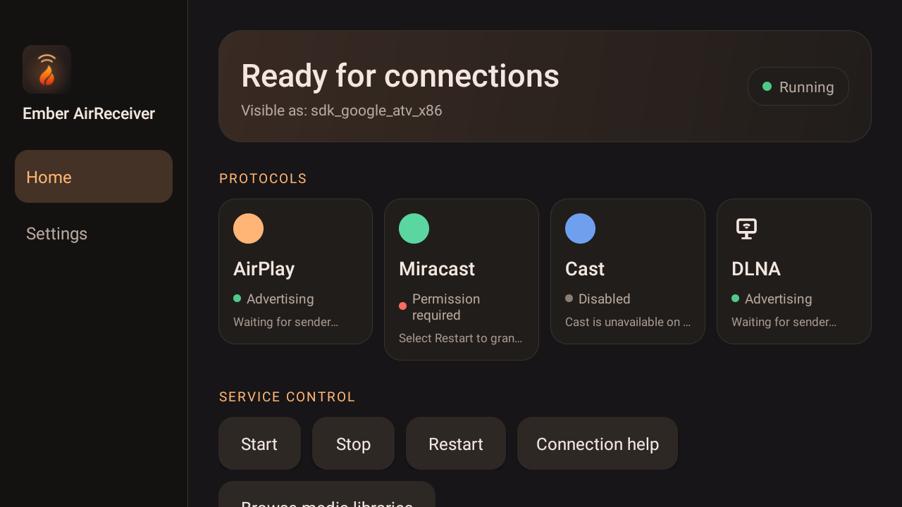
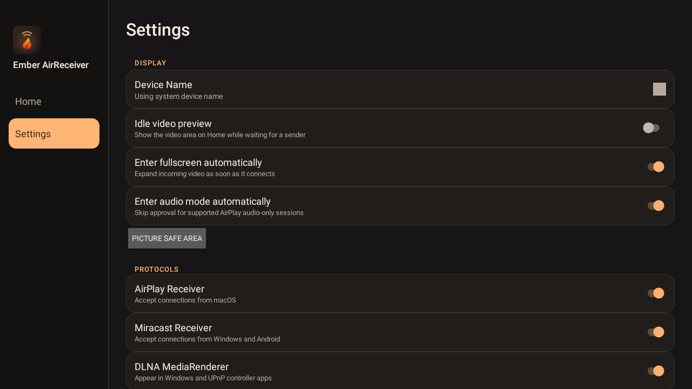
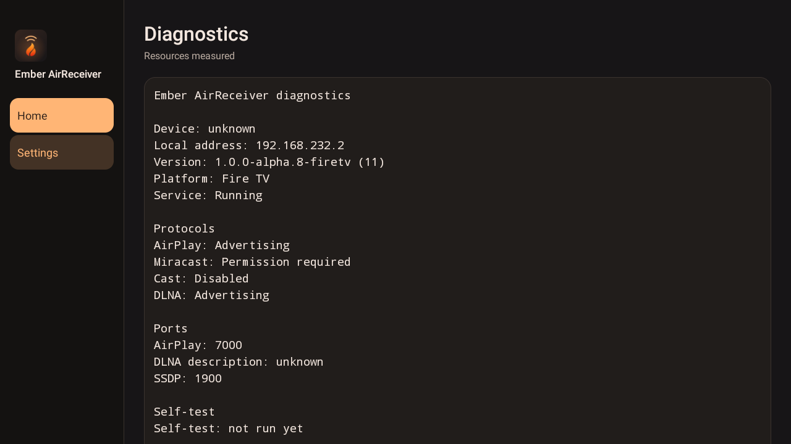

<p align="center">
  
</p>

<h1 align="center">Put your screen on the TV</h1>

<p align="center">
  Screen mirroring, music and local media for Google TV, Android TV and Fire TV.
</p>

<p align="center">
  <a href="https://github.com/PrimeN/Ember-AirReceiver/actions/workflows/android.yml?query=branch%3Abeta"></a>
  <a href="LICENSE"></a>
</p>

<p align="center">
  <a href="#install">Install</a> ·
  <a href="#features">Features</a> ·
  <a href="#screenshots">Screenshots</a> ·
  <a href="#build">Build</a> ·
  <a href="PRIVACY.md">Privacy</a> ·
  <a href="https://github.com/PrimeN/Ember-AirReceiver/issues">Report an issue</a>
</p>

## Features

| Feature | What you can do |
| --- | --- |
| AirPlay | Mirror an iPhone, iPad or Mac, play supported audio or media URLs, and view shared photos. |
| Wireless display | Mirror from compatible Miracast senders on TVs with Wi-Fi Direct and the required device permissions. |
| DLNA | Play media from a DLNA controller or browse local media libraries from Home. |
| Cast Connect | Receive supported Cast sessions on Google TV builds configured with a registered Cast application ID. |
| Receiver controls | Start or stop each available receiver from its Home tile and choose whether to start receivers when Ember opens. |
| Playback settings | Configure AirPlay PINs, sender handoff, fullscreen and audio approval, picture safe area, mirroring resolution and maximum FPS. |

Mirroring and discovery depend on the sender, TV hardware and network. Protected
AirPlay video and buffered AirPlay 2 audio are currently unsupported. Standard
APK artifacts omit Cast Connect configuration.

## Screenshots

| Home | Settings |
| --- | --- |
|  |  |

<details>
  <summary>Diagnostics</summary>

  
</details>

Captured from the Fire TV variant running in an Android TV emulator. Receiver
availability depends on device support and permissions.

## Install

Open a successful [beta build](https://github.com/PrimeN/Ember-AirReceiver/actions/workflows/android.yml?query=branch%3Abeta)
and download the artifact for your TV. Unzip the artifact and install its APK.

| TV | Minimum version | Artifact |
| --- | --- | --- |
| Google TV or Android TV | Android 10 | `Ember-AirReceiver-GoogleTV-debug-<build number>` |
| Fire TV | Android 7.1 | `Ember-AirReceiver-FireTV-debug-<build number>` |

1. Open Ember on your TV and use the Home tiles to enable the receivers you want.
2. Connect the sender and TV to the same local network for AirPlay or DLNA. On a
   compatible Miracast sender, open its wireless display menu.
3. Select the receiver name shown in Ember. For local DLNA libraries, turn on
   the DLNA tile and select **Browse media libraries** on Home.

## Build

Install JDK 17, Android SDK platform 35, Build Tools 35.0.0, NDK 28.2.13676358,
and CMake 3.22.1.

```sh
./gradlew :test-runner:test :app:assembleGoogletvDebug :app:assembleFiretvDebug
```

Gradle writes APKs under `app/build/outputs/apk/`. To enable Cast Connect in a
Google TV build, provide a registered ID through `AIRRECEIVER_CAST_APP_ID` or
the `airreceiver.castAppId` Gradle property.

On GitHub, **Build APKs** uploads an installable debug APK for each TV flavor.
For signed release artifacts, run the workflow manually on `beta` or `main`
with **Build signed release APKs for Google TV and Fire TV** selected. Configure
`EMBER_KEYSTORE_BASE64`, `EMBER_KEYSTORE_PASSWORD`, `EMBER_KEY_ALIAS`, and
`EMBER_KEY_PASSWORD` in the repository's Actions secrets.

[License](LICENSE) · [Privacy policy](PRIVACY.md)
